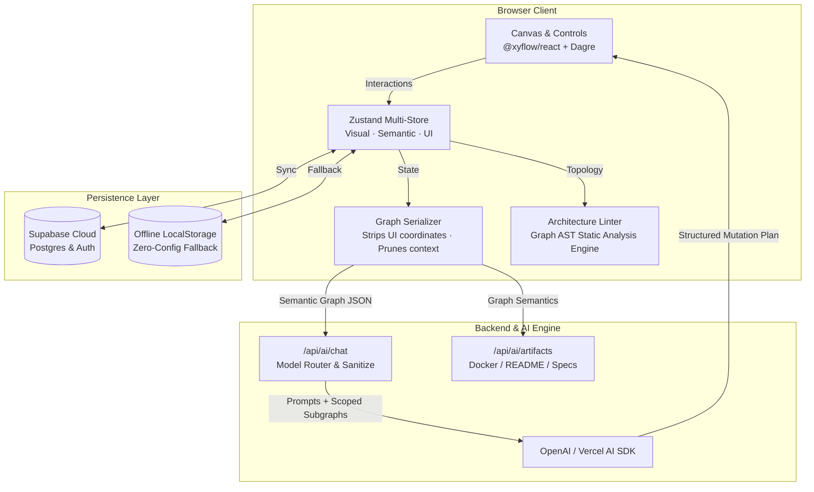

# Flowboard ⚡

> **AI-Augmented Visual Architecture Studio & Infrastructure Compiler**  
> *Map distributed topologies, audit system anti-patterns with real-time static analysis, and collaborate with a safe human-in-the-loop AI copilot that compiles diagrams into deployable infrastructure artifacts.*

[](https://github.com/vaishnavijagtap02/Flowboard/actions)
[](https://vitest.dev/)
[](https://nextjs.org/)
[](https://react.dev/)
[](https://www.typescriptlang.org/)
[](https://turbo.build/)
[](https://zustand.docs.pmnd.rs/)
[](LICENSE)

---

## 💡 Overview

Traditional system architecture diagrams (draw.io, Miro, Lucidchart) suffer from a critical flaw: **they are static, dead pictures**. They cannot validate connection protocols, detect circular dependencies, catch single points of failure (SPOFs), or compile into real code.

**Flowboard transforms architecture design into an active, intelligent compiler:**
1. **Semantic Graph Model**: Every node and edge is typed with real engineering primitives (`service`, `database`, `queue`, `cache`, `gateway`, `client`) and protocols (`TCP/RESP`, `publishes_to`, `reads_from`).
2. **Deterministic Architecture Linter**: Client-side graph algorithms perform static analysis on your topology, highlighting anti-patterns and performance bottlenecks before you write code.
3. **Safe Agentic AI Copilot**: Rather than hallucinating or blindly mutating your canvas, the AI evaluates the semantic graph and generates structured mutation proposals. You review visual diffs (`+ ADD NODE`, `~ UPDATE`, `+ ADD EDGE`) before approving with automated Dagre topological re-layout.
4. **Artifact Compiler**: Compiles the validated graph directly into production-ready `docker-compose.yml`, system READMEs, API contract stubs, and environment configs.

---

## 🏛️ System Architecture



---

## ⚡ Key Engineering Decisions

### 1. Decoupled Visual vs. Semantic State
* **The Problem**: LLMs struggle with spatial coordinates (producing overlapping or misaligned nodes) and visual coordinate bloat inflates context token usage.
* **The Solution**: Flowboard isolates volatile canvas coordinates (`x`, `y`, `zoom`, `viewport`) from domain semantics (`type`, `tech`, `responsibilities`, `protocol`). The `GraphSerializer` strips visual data, reducing LLM token consumption by **~60%** while ensuring layout calculations remain deterministic via Dagre.

### 2. Human-in-the-Loop Safe Agentic Workflow (Propose → Diff Review → Apply)
* **The Problem**: Autonomous AI agents that directly mutate UI canvas state cause destructive overwrites and user frustration.
* **The Solution**: The AI generates a discriminated-union mutation schema validated with Zod (`ADD_NODE`, `REMOVE_NODE`, `UPDATE_NODE`, `ADD_EDGE`, `REMOVE_EDGE`). Flowboard renders an interactive diff review panel where developers inspect rationales and approve or reject changes before applying them.

### 3. Static Architecture Analysis Engine (AST Linter)
* Implemented client-side graph traversal algorithms that audit topology health:
  * **Single Points of Failure (SPOF)**: Services serving high outbound traffic without redundancy.
  * **Direct Database Coupling**: Multiple services reading/writing to a shared database bypassing API boundaries.
  * **Unbuffered Write Pipelines**: High-frequency services writing synchronously to storage without an intermediary message queue.
  * **Circular Call Graphs**: Detection of cyclic dependencies causing distributed deadlocks.

### 4. Zero-Config Sandbox Mode & Graceful Degradation
* Designed to work completely out-of-the-box. If `OPENAI_API_KEY` or `NEXT_PUBLIC_SUPABASE_URL` are not provided, Flowboard automatically switches to a local deterministic simulation engine and localStorage persistence, allowing interviewers and visitors to explore the entire workflow with zero setup.

---

## 🛠️ Tech Stack

| Layer | Technologies |
|---|---|
| **Framework & Engine** | Next.js 16 (App Router, Turbopack), React 19, TypeScript 5 |
| **Canvas & Layout** | `@xyflow/react` (React Flow 12), `dagre` (Hierarchical auto-layout) |
| **State Management** | `zustand 5` (Decoupled Visual, Semantic, and UI stores) |
| **Styling & Motion** | Tailwind CSS v4, Framer Motion, Base UI, Lucide Icons |
| **AI Integration** | Vercel AI SDK (`ai`), OpenAI API, Zod Schema Validation |
| **Database & Auth** | Supabase (PostgreSQL, Realtime, Session Auth) + LocalStorage Fallback |
| **Developer Tooling** | ESLint 9 (Strict Next core-web-vitals & TypeScript config) |

---

## ✨ Features Walkthrough

- 📷 **Vision OCR & Screenshot-to-Architecture Scanner**: Drag & drop or direct-paste (`Ctrl+V` / `Cmd+V`) whiteboard sketches or meeting screenshots. Multimodal GPT-4o vision reverse-engineers nodes, technologies, and protocols, then reconstructs the canvas with automated Dagre layout.
- 🎨 **Interactive Node-Graph Canvas**: Drag-and-drop semantic primitives (Service, Database, API, Queue, Cache, Gateway, Client).
- 📐 **Dagre Topological Auto-Layout**: Auto-arranges messy diagrams into clean, hierarchical engineering topologies with a single click.
- 💬 **AI Copilot with Context Scoping**: Asks the LLM to optimize read latency, decouple bottlenecks, or introduce caching layers.
- 🔍 **Architecture Health Drawer**: Real-time diagnostic panel computing topology health scores and recommending targeted remediations.
- 📦 **Infrastructure Artifact Compiler**: One-click generation of:
  - `docker-compose.yml` with ports, volumes, and health checks configured for every service.
  - Architecture README documentation detailing system boundaries.
  - API TypeScript interfaces and environment configuration templates (`.env.example`).
- 🌗 **Midnight Navy & Ice Blue Theme**: Classy, bespoke dark and light modes with tactile handles and frosted glass elevations.
- 🧪 **Pre-built Architecture Templates**: Instant sandbox blueprints (E-Commerce Microservices, Event-Driven Streaming, Serverless API).

---

## 🚀 Getting Started

### Prerequisites
- Node.js 18.18+ or 20+
- npm, pnpm, or yarn

### 1. Clone & Install
```bash
git clone https://github.com/vaishnavijagtap02/Flowboard.git
cd Flowboard
npm install
```

### 2. Environment Configuration (Optional)
Flowboard includes a fully functional sandbox mode out-of-the-box. To enable live OpenAI streaming and cloud persistence, create a `.env.local` file:

```bash
cp .env.example .env.local
```

Fill in the optional credentials:
```env
# Optional: Enables live OpenAI LLM streaming copilot
OPENAI_API_KEY=sk-...

# Optional: Enables cloud persistence and multi-user authentication
NEXT_PUBLIC_SUPABASE_URL=https://your-project.supabase.co
NEXT_PUBLIC_SUPABASE_ANON_KEY=your-anon-key
```

### 3. Run Development Server
```bash
npm run dev
```
Open [http://localhost:3000](http://localhost:3000) in your browser.

### 4. Build & Verify
```bash
# Run automated test suite (20 unit tests)
npm test

# Type check
npm run typecheck

# Lint check (0 errors, 0 warnings)
npm run lint

# Production build with Turbopack
npm run build
```

---

## 📂 Project Structure

```
Flowboard/
├── src/
│   ├── app/                      # Next.js 16 App Router pages & API routes
│   │   ├── api/ai/chat/          # AI chat endpoint with model routing & mutation logic
│   │   ├── api/ai/artifacts/     # Artifact compiler (Docker Compose, READMEs)
│   │   ├── api/boards/           # Persistence endpoints (save, load, list, delete)
│   │   ├── board/                # Main architecture canvas workspace
│   │   ├── dashboard/            # User architecture project manager
│   │   ├── demo/                 # Sandbox environment with pre-loaded blueprints
│   │   └── page.tsx              # Awwwards-grade product landing page
│   ├── components/
│   │   ├── artifacts/            # Artifact preview modal & download actions
│   │   ├── canvas/               # React Flow canvas, node palette, custom nodes
│   │   ├── chat/                 # Copilot messages, mutation plan diff reviews
│   │   ├── inspector/            # Architecture health drawer & linter report
│   │   ├── landing/              # Interactive hero, feature cards, showcase
│   │   ├── sidebar/              # Property inspector for nodes & edges
│   │   └── toolbar/              # Workspace actions, auto-layout, export
│   ├── engine/                   # Core algorithmic engine
│   │   ├── linter.ts             # Deterministic architecture static analyzer
│   │   ├── mutationEngine.ts     # Mutation parsing, verification & application
│   │   ├── serializer.ts         # Strips visual state -> clean semantic graph
│   │   ├── layoutEngine.ts       # Dagre hierarchical layout calculations
│   │   └── subgraph.ts           # Subgraph scoping & token pruning
│   ├── schemas/                  # Zod validation schemas for requests & mutations
│   ├── stores/                   # Zustand state stores (canvas, chat, ui)
│   └── types/                    # Core semantic, canvas, and artifact type definitions
├── SYSTEM_DESIGN.md              # In-depth architectural specification
└── README.md                     # Project overview and technical showcase
```

---

## 📄 License

This project is licensed under the [MIT License](LICENSE).
